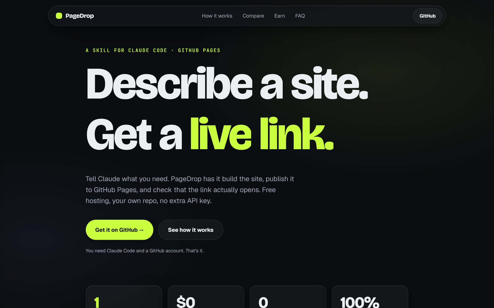
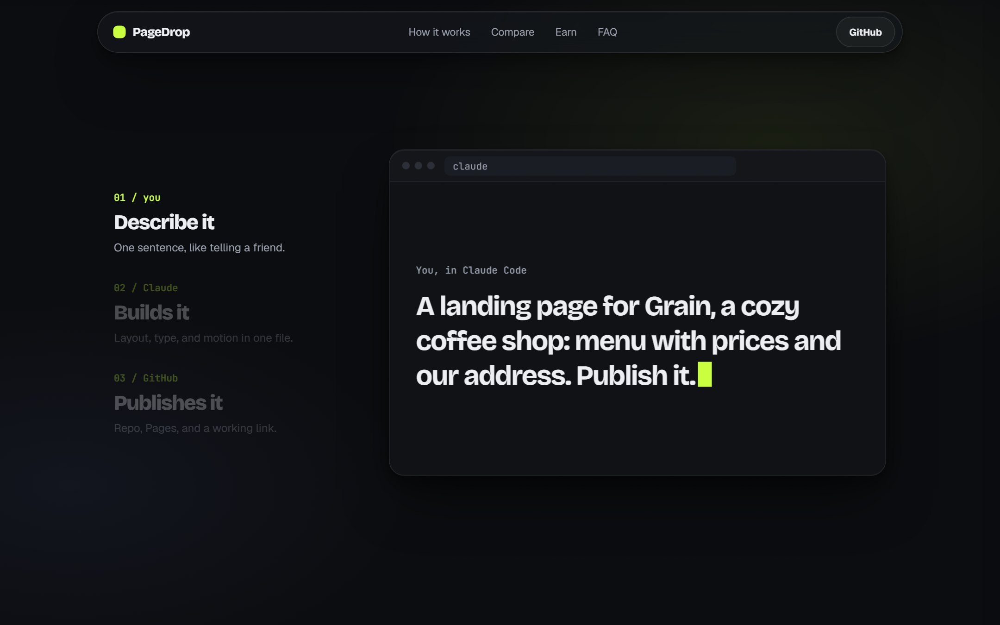
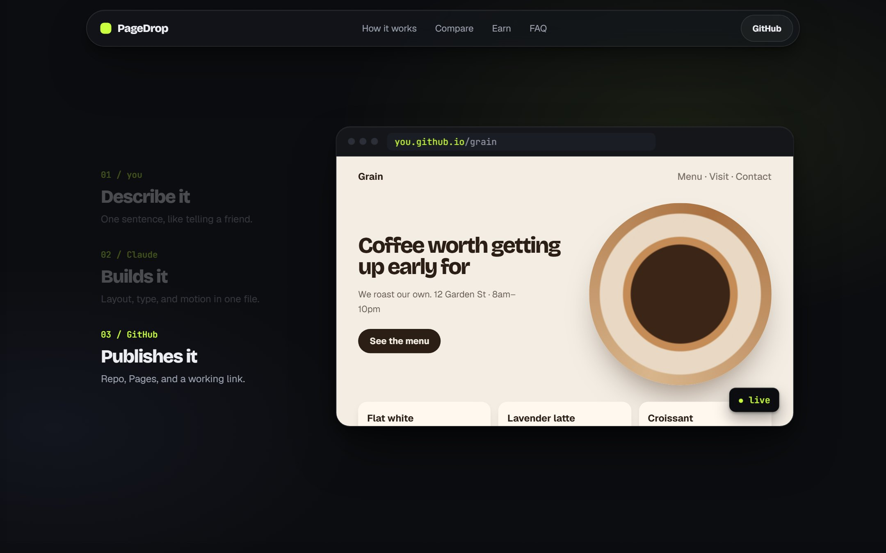

<div align="center">

# PageDrop

### Describe a site. Get a live link.

A Claude Code skill: Claude builds your website, publishes it to GitHub Pages,<br>
and checks that the link actually opens. **Free hosting. Your own repo. No extra API key.**

[**Live demo**](https://ildargiv.github.io/pagedrop/) · [Install](#install) · [How it works](#how-it-works) · [Example prompts](#example-prompts) · [FAQ](#faq)



<sub>This landing page — and this whole repository — was published by PageDrop's own `publish.py`.</sub>

</div>

---

## Why PageDrop

Getting a simple site online still means picking a builder, paying monthly, and living on someone else's platform. Or it means code, a repo, a deploy config, and DNS.

**PageDrop turns all of that into one conversation.** You say what you need; Claude writes the site and runs a publishing script that does the GitHub part for you.

| | **PageDrop** | AI site builders (Lovable, Durable, Framer) |
|---|---|---|
| Price | **Included in your Claude Code plan** | A subscription from $10–25 a month |
| Hosting | **GitHub Pages, free** | Included in the subscription |
| If you stop paying | **The site keeps running** | Depends on the plan |
| Code | **Open, in your own repository** | A closed platform |
| Setup | Claude Code and a GitHub account | Nothing, it all runs in the browser |

<sub>Competitor prices are from public reviews for 2026.</sub>

<table>
<tr>
<td width="50%"><br><sub><b>1. Describe it.</b> One message in Claude Code.</sub></td>
<td width="50%"><br><sub><b>2. It's live.</b> A real URL on GitHub Pages, checked before you get it.</sub></td>
</tr>
</table>

## Everything you get

### 🚀 From idea to URL in one conversation
- **A short brief, not an interview.** At most three questions, only about what you didn't already say.
- **A site a studio would sign.** One clear idea on the first screen, a deliberate palette, a real type pairing, responsive from 360px up, proper meta and social tags.
- **Checked before it ships.** Claude opens the page at desktop and phone widths and fixes console errors, sideways scrolling, and broken images first.
- **A link that really works.** The script waits for the Pages build to finish for *your* commit and confirms the URL returns 200. "Pushed" is never reported as "live".

### ✏️ Change it in plain words
- "Add our opening hours", "make the button bigger", "swap the photo" — Claude edits only that and republishes with `--update`.
- **Every publish is a commit,** so any version can be restored from the git history.
- Lost the folder? It clones the repo and keeps going.

### 🌐 Your own domain
- Ask for it and the script writes `CNAME`, sets the domain in Pages, and prints the **exact DNS records** to add — four `A` records for `example.com`, or a `CNAME` for `www.example.com`. HTTPS turns on by itself.

### 🔐 Safe by design
- **Uses credentials you already have:** `GITHUB_TOKEN`, the GitHub CLI, or the git credential manager. The token is passed to git through environment config — **never printed, never written to `.git/config`, never in the process arguments.**
- **Refuses to overwrite** an existing repository unless you explicitly ask to update it.
- **Refuses to hijack** a folder whose git remote points somewhere else.
- **Asks before going public**, unless you already said "publish".
- **Never asks you to paste a token into the chat.**

### 🪶 Nothing to set up
- Pure Python standard library plus git. No npm, no build step, no framework.
- Sites are single self-contained HTML files that work on any static host.

### ✨ Motion design on request
- Install the companion **[motion-site](https://github.com/ildargiv/motion-site)** skill and ask for "motion": scroll scenes, masked text reveals, odometers, and a frame-by-frame review loop until every scene scores 9/10.

### 💸 Earn with it
The most convincing pitch is a finished site. [One developer built mockups for 11 local businesses without websites; five bought a site for about $1,000 each.](https://vibecodewithamber.substack.com/p/how-i-made-5000-in-a-week-selling) With PageDrop, every mockup is already a live link you can send.

## Install

Inside Claude Code:

```
/plugin marketplace add ildargiv/pagedrop
/plugin install pagedrop@pagedrop
```

Or from your shell:

```bash
claude plugin marketplace add ildargiv/pagedrop
claude plugin install pagedrop@pagedrop
```

**GitHub access** — any one of these:
- you've pushed to GitHub with git on this machine before (the credential manager remembers you), or
- `gh auth login` with the [GitHub CLI](https://cli.github.com/), or
- a `GITHUB_TOKEN` environment variable with a [fine-grained token](https://github.com/settings/personal-access-tokens/new) that has **Administration**, **Contents**, and **Pages** set to read and write.

## How it works

1. **Brief** — what the site is for, the real content, and a repository name (it becomes `<you>.github.io/<repo>/`).
2. **Build** — a self-contained `index.html` in a new folder.
3. **Check** — desktop and phone widths, no console errors, no sideways scroll.
4. **Publish** — `scripts/publish.py` creates the repo, pushes, enables Pages, and waits.
5. **Verify** — Claude opens the live URL itself before handing it to you.

The script on its own:

```bash
python publish.py ./my-site --repo my-site --description "Landing for a coffee shop"
python publish.py ./my-site --repo my-site --update
python publish.py ./my-site --repo my-site --update --domain www.example.com
```

Its last line is always a JSON summary: `{"status": "live", "url": "...", "repo": "..."}`.

## Example prompts

> Make a one-page site for my bakery "Crumb": we bake sourdough, open 7am–3pm, 14 Harbor Road. Publish it.

> I need a portfolio for my photography. Dark, minimal, a grid of the photos in `./photos`. Call the repo `lena-photo`.

> Put my resume online as a clean web page. Here it is: …

> Change the headline on my `crumb` site to "Bread worth the wait" and connect crumbbakery.com.

## FAQ

**What does it cost?** Nothing beyond the Claude Code you already use. GitHub Pages is free for public repositories.

**What kinds of sites?** Static ones: landing pages, portfolios, event pages, menus, resumes, documentation. No server code, databases, or user accounts — that's GitHub Pages. Forms work through services like Formspree or a `mailto:` link.

**Is my site public?** Yes — free Pages requires a public repository, so never put private data in it. Pages on private repositories needs a paid GitHub plan (`--private`).

**Can I take the site elsewhere later?** Yes. It's plain HTML in your repo; Netlify, Vercel, Cloudflare Pages, or any server will host it as-is.

## What's inside

```
pagedrop/
├── .claude-plugin/marketplace.json
├── plugins/pagedrop/
│   ├── .claude-plugin/plugin.json
│   └── skills/pagedrop/
│       ├── SKILL.md            the workflow: brief, build, check, publish, verify, update
│       └── scripts/publish.py  GitHub repo + Pages + live check, standard library only
└── index.html                  this project's landing page (published with publish.py)
```

## License

[MIT](LICENSE)
